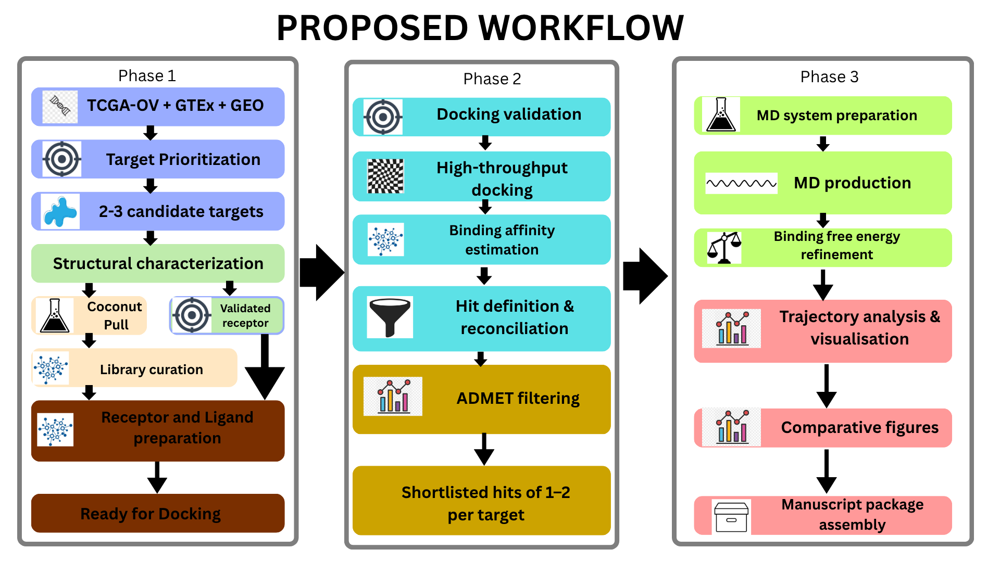

# ROOTS

*Receptor-oriented Oncotarget Screening of Natural Compounds Under Thermodynamic Simulation in Ovarian Cancer*

Supervisor: Dr. Olaitan Awe. Team Lead: Dr. Adedeji J.A.

Status: pre-execution. Design complete and stress-tested; no data has been generated yet.

---

## Overview

Ovarian cancer kills more people than most gynaecological cancers because it is caught late, and the tools that catch other cancers early do not exist for it yet. The therapies that work are effective where a patient can reach them, but their cost and distribution put them out of reach for underserved and low- and middle-income populations. What starts as a biology problem ends as a structural one.

Natural compounds and phytochemicals are a large, comparatively under-characterised chemical space. The field has produced some of oncology's most important drugs from this space, and most of it remains unexplored against specific cancer targets.

ROOTS narrows that gap using omics-derived target discovery and free-tier compute to find natural-product candidates worth pursuing further, without the resource-intensive screening infrastructure most pipelines assume from the start. My pipeline is not a substitute for wet-lab validation or clinical development. It is a methodologically rigorous first step toward treatment options that do not assume the patient can already afford the alternative.

## Table of Contents

- [Overview](#overview)
- [Proposed Pipeline](#proposed-pipeline)
- [Methodology in Detail](#methodology-in-detail)
- [The Molecular Dynamics Bottleneck](#the-molecular-dynamics-bottleneck)
- [Existing Pipelines and the Gaps They Leave](#existing-pipelines-and-the-gaps-they-leave)
- [Points of Novelty](#points-of-novelty)
- [Validation and Benchmarking Strategy](#validation-and-benchmarking-strategy)
- [Testing and Validation Datasets](#testing-and-validation-datasets)
- [Compute and Infrastructure](#compute-and-infrastructure)
- [Repository Structure](#repository-structure)
- [Current State](#current-state)
- [Team](#team)
- [References](#references)

---

## Proposed Pipeline

The pipeline runs in three phases. Each phase depends entirely on the output of the one before it.



**Phase 1: Target and structure discovery**

TCGA-OV + GTEx + GEO, leading to target prioritisation, 2-3 candidate targets, structural characterisation, the COCONUT library pull and validated receptor branch, library curation, receptor and ligand preparation, and a system ready for docking.

**Phase 2: Screening and selection**

Docking validation, high-throughput docking, binding affinity estimation, hit definition and reconciliation, ADMET filtering, and a shortlist of one to two hits per target.

**Phase 3: Simulation, refinement, and output**

MD system preparation, MD production, binding free energy refinement, trajectory analysis and visualisation, comparative figures, and manuscript package assembly.

---

## Methodology in Detail

### Bioinformatics

- **Target prioritisation:** TCGA-OV versus GTEx-ovary differential expression through DESeq2/apeglm via recount3, with ComBat-seq mitigation, an independent GEO cohort for concordance, GDC/cBioPortal mutation frequency, an HPA protein-level check, and a fallopian-tube tissue-of-origin screen. Output: 2-3 candidate targets.
- **Structural characterisation:** PDB search first, gated on resolution, coverage, and organism; AlphaFold3 as fallback, validated by TM-score and pocket-level pLDDT. One structural state carried forward per target.
- **Compound library curation:** COCONUT as the sole source, archived at retrieval. Ro5, Veber, and PAINS filtering, then a cap of roughly 500-2,000 compounds. A stereochemistry-integrity check confirms defined stereocentres survive 3D embedding.
- **Receptor and ligand preparation:** CHARMM-GUI and PDB2PQR for protonation, Meeko for PDBQT conversion, the same protocol regardless of where the structure came from.

### Cheminformatics

- **Docking validation:** a per-target re-docking RMSD check using AutoDock Vina and MDAnalysis, run independently of the AlphaFold3 structural validation.
- **High-throughput docking:** the full library docked with Vina on Kaggle, using its published GPU quota, chunked and checkpointed.
- **Binding affinity estimation:** PRODIGY-LIG, the ligand-adapted tool, distinct from protein-protein PRODIGY, cross-validated against Vina's native score.
- **Hit definition and reconciliation:** a statistical threshold set per target, a split between consensus and selective hits, and a promiscuity sanity check on the consensus set.
- **ADMET filtering:** two tiers. ADMET-AI triages the full hit set locally with no cap, then SwissADME, pkCSM, and ADMETlab 2.0 apply to the smaller final shortlist.

### Molecular Dynamics

- **MD system preparation:** complex-only, the top one to two hits per target with both consensus and selective candidates represented, built in CHARMM-GUI Solution Builder. Two to six systems total.
- **MD production:** GROMACS on Colab with Drive-synced checkpointing. Trajectory length is set by convergence, 50-100 ns, not a fixed default. Metadynamics is out of scope for this pass.
- **Binding free energy refinement:** gmx_MMPBSA, run in the same Colab environment across the full trajectory window.
- **Trajectory analysis and visualisation:** MDAnalysis and PLIP on a representative frame from the converged window, matplotlib and seaborn for figures, Py3Dmol for structure views, plus one cross-target comparative figure.
- **Manuscript package assembly:** separate Colab and Kaggle environment files, an execution-map README, one figures notebook, and a GitHub release archived with a Zenodo DOI.

---

## The Molecular Dynamics Bottleneck

MD gives the pipeline its name, and it is also the natural bottleneck. Free-tier notebook sessions have real limits, and a workflow built around thermodynamic simulation has to plan for that from the start rather than discover it mid-run.

- A recompiled GROMACS build on Colab writes checkpoints to Google Drive at fixed intervals, so a session timeout becomes a pause instead of lost work. The method is published and benchmarked (Karagöl & Karagöl, 2024).
- Trajectory length follows convergence rather than a fixed number: each system runs at least 50 ns and extends only as far as RMSD plateauing requires, up to a 100 ns ceiling.
- Scope is narrowed upstream: one to two hits per target, two to six systems total, with enhanced sampling and metadynamics set aside as future extensions rather than run by default.

Together, these keep the MD workload bounded and achievable on free-tier hardware instead of open-ended.

---

## Existing Pipelines and the Gaps They Leave

Comparable pipelines exist in the literature. None combines what ROOTS combines.

| Study | Target | Approach |
|---|---|---|
| Pham et al. (2026) | CDK12, pan-cancer including ovarian | TCGA/GTEx omics into docking, MD, and MM-PBSA against Vietnamese natural products |
| Shibu et al. (2026) | WNT5A, ovarian | GEO2R differential expression, AlphaFold structure, phytocompound docking, MD, FEL, DCCF, FEP |
| Masoudi et al. (2025) | CDK1/WEE1, ovarian | ML-based prioritisation, docking, MD; naringin identified as lead |
| Sharma et al. (2026) | PD-1 | Consensus docking across seven algorithms, 300 ns MD, DFT, ADME |
| Luo et al. (2022) | CDK4/6 | Pharmacophore filtering of marine natural products, ADMET, docking, MD |
| Liu & Ji (2026) | ClC-3, cervical | AI-driven docking, deep-learning rescoring, pharmacokinetic filtering, MD |

**The gaps across this body of work:**

- Every study fixes its target by literature precedent. None runs a multi-cohort omics prioritisation before structure work starts.
- Normal-tissue comparator design is weak or missing. TCGA-OV's near-absence of matched normal samples goes unaddressed, and tissue of origin (fallopian tube versus ovarian surface epithelium) is not raised anywhere in this set.
- No study reports an independent second-cohort concordance check. Differential expression comes from a single cohort throughout.
- None cross-checks a differential-expression target against independent protein-level data before moving to structure work.
- Where AlphaFold is used, confidence gating is loose, for example "the highest-confidence model" with no pocket-specific pLDDT threshold stated.
- Docking protocol validation, re-docking a known reference ligand to confirm RMSD, is not a described step in any of these pipelines.
- Stereochemistry integrity for natural-product libraries goes unaddressed everywhere, despite Ro5 and PAINS filtering being universal.
- No promiscuity check or consensus/selective hit framework exists. Each study reports a single best hit with no statistical threshold behind it.
- ADMET tooling limits, SwissADME and pkCSM cap submissions around 100-200 molecules, go unaddressed at any scale where they would matter.
- Trajectory lengths are fixed in advance (100, 200, 300 ns quoted as flat numbers), and no pipeline documents a verified zero-cost compute stack with reproducibility archiving.

### Comparison of Pipelines

| Gap in existing pipelines | How ROOTS addresses it |
|---|---|
| Target fixed by literature precedent before any omics | Full multi-cohort differential expression, mutation frequency, and protein-level prioritisation run first; 2-3 candidates carried forward comparatively |
| Weak or absent matched-normal-tissue handling; tissue of origin ignored | Harmonised TCGA-OV versus GTEx-ovary via recount3, the confound stated plainly, plus a fallopian-tube-origin literature cross-check |
| Single-cohort differential expression, no independent concordance check | An independent GEO cohort must show the same direction of change before a target survives |
| No orthogonal protein-level confirmation | HPA immunohistochemistry cross-check on shortlisted targets |
| Loose AlphaFold confidence gating | Dual-layer validation: whole-protein TM-score plus pocket-lining pLDDT; PDB preferred under explicit resolution, coverage, and organism criteria |
| Docking protocol validity assumed, not tested | Per-target re-docking of a known ligand with an RMSD check before any large-scale screening |
| Stereochemistry integrity unaddressed for natural products | A check confirms defined stereocentres survive 3D embedding; failures are logged and excluded |
| Single best hit reported, no promiscuity screen | A statistical hit threshold per target, a consensus-versus-selective split, and a promiscuity sanity check on molecular weight, logP, and aromatic ring count |
| Web ADMET tools cap submissions near 100-200 molecules | Local ADMET-AI triages the full hit set with no cap; capped web tools handle the smaller final shortlist |
| Fixed trajectory lengths set in advance; no documented low-cost infrastructure | Trajectory length follows convergence on a verified free-tier Colab and Kaggle stack, with checkpoint recovery and a GitHub plus Zenodo archived package |

---

## Points of Novelty

No single tool in ROOTS is new. The contribution sits in the architecture.

- Target selection is omics-derived across 2-3 candidates rather than fixed in advance, which sets it apart from comparable published pipelines that start from one pre-chosen target.
- The comparator design corrects a weakness documented across ovarian cancer transcriptomic work: TCGA-OV's near-absence of matched normal samples. The harmonised TCGA-versus-GTEx design states the confound plainly and reinforces it with GEO concordance, the fallopian-tube check, and HPA confirmation.
- The pipeline carries targets through every evidentiary layer, from transcriptomic discovery to thermodynamic validation on the same candidates, where comparable work usually stops earlier or starts later.
- The full scope runs on a verified, zero-cost compute stack, including a demonstrated answer to the MD infrastructure barrier described above.

---

## Validation and Benchmarking Strategy

No wet-lab confirmation exists at this stage. Validation is built into each computational layer instead of deferred to a single endpoint.

- Target selection is checked against an independent measurement type, HPA immunohistochemistry, rather than resting on transcriptomics alone, plus a fallopian-tube literature check for tissue-of-origin artefacts.
- Structural reliability is benchmarked with numbers: TM-score against known folds and pocket-level pLDDT for predicted structures, re-docking RMSD against a known ligand for every target.
- Binding affinity does not rest on one method. PRODIGY-LIG and Vina's native score are checked against each other, and disagreement is reported rather than resolved by preference.
- Thermodynamic stability rests on demonstrated RMSD convergence, not an assumed trajectory length, and instability is treated as a genuine result rather than a failed run.
- What remains unvalidated at this stage, replicate-based MD convergence and any biological activity claim beyond computational ranking, is stated as a scope boundary, not glossed over.

---

## Testing and Validation Datasets

### Testing dataset

The data used to build and tune the pipeline.

- **Discovery layer:** TCGA-OV tumour versus GTEx ovary normal, harmonised through recount3.
- **Supporting evidence:** pre-called mutation data from GDC and cBioPortal, and Human Protein Atlas immunohistochemistry.
- **Screening library:** the COCONUT natural-product database, filtered to the roughly 500-2,000-compound working set.
- **Structural inputs:** PDB where a qualifying structure exists, otherwise AlphaFold3, plus a known co-crystallised reference ligand per target for the docking-protocol RMSD test.

### Independent validation dataset

Separate from the testing data above, chosen specifically to share no provenance with it.

- **Target-level cohort:** an ovarian cancer cohort outside TCGA, GTEx, and the internal GEO validation series, such as the Australian Ovarian Cancer Study, ICGC-OV, or a second, distinct GEO series. This checks whether the prioritised target's dysregulation holds in a population and sequencing effort with no shared lineage to the discovery data.
- **Orthogonal molecular layer:** CPTAC-OV mass-spectrometry proteomics (Zhang et al., 2016), a proteomic characterisation of 174 ovarian tumours also studied by TCGA. It overlaps TCGA-OV at the patient level through a different assay than the HPA immunohistochemistry already in use internally.
- **Functional layer:** DepMap CRISPR knockout gene-effect scores across ovarian cancer cell lines, testing whether the prioritised target is functionally required for viability, using a data type the omics and docking design never touches.
- **Compound and hit-level validation:** ChEMBL, BindingDB, or NPASS bioactivity records for the final hits or close structural analogues, checked against the same target family independent of the internal Vina and PRODIGY-LIG scores.

---

## Compute and Infrastructure

- **Google Colab:** the primary environment for omics analysis, library curation, receptor and ligand preparation, MD production, MM-PBSA, and trajectory analysis, with Drive-synced checkpointing on every long-running job.
- **Kaggle Notebooks:** GPU-bound high-throughput docking, chosen for a published, predictable weekly GPU quota rather than Colab's undocumented, variable allocation.
- **Zero cost throughout:** every tool in the pipeline was checked for free-tier or open-source availability before it was locked into the design.
- **Reproducibility:** raw database pulls archived at the point of retrieval, fixed random seeds wherever applicable, every intermediate artefact and environment specification under version control, and the final package archived with a Zenodo DOI.

---

## Repository Structure

```
ROOTS/
|-- 01_target_prioritisation/
|-- 02_structure_and_library/
|-- 03_screening_and_selection/
|-- 04_md_simulation/
|-- environments/
|   |-- colab_environment.yml
|   `-- kaggle_environment.yml
|-- docs/
|   `-- execution_map.md
|-- outputs/
`-- README.md
```

`[Placeholder: insert a repository or folder screenshot here, if useful.]`

---

## Current State

ROOTS is a fully specified, internally audited protocol. The design has been checked for internal consistency, computational achievability under a genuine zero-cost constraint, and defensibility against the objections a reviewer would raise first. Real corrections were made and documented along the way rather than smoothed over:

- A transcriptomic comparator confound between TCGA-OV and GTEx was identified and stated plainly rather than assumed resolved.
- A tool-identity error between PRODIGY (protein-protein) and PRODIGY-LIG (protein-ligand) was caught and corrected.
- An inherited assumption that Colab cannot run molecular dynamics reliably was overturned by a published, benchmarked checkpoint-persistence method.

Execution has not started. The pipeline begins with the omics discovery layer, since every downstream cheminformatics and MD step depends on its output.

`[Placeholder: insert a current-progress or status graphic here, if useful.]`

---

## Team

- **Team Lead:** Dr. Adedeji J.A.
- **Supervisor:** Dr. Olaitan Awe
- **Roles under recruitment:** omics and statistics, structural and docking, MD and thermodynamics, integration and statistical review.

`[Placeholder: insert team photo or headshots here, if used.]`

---

## References

Abraham, J., Adler, J., Dunger, J., Evans, R., Green, T., Pritzel, A., Ronneberger, O., Willmore, L., Ballard, A. J., Bambrick, J., Bodenstein, S. W., Evans, D. A., Hung, C.-C., O'Neill, M., Reiman, D., Tunyasuvunakool, K., Wu, Z., Žemgulytė, A., Arvaniti, E., ... Jumper, J. M. (2024). Accurate structure prediction of biomolecular interactions with AlphaFold 3. *Nature*, *630*(8016), 493-500. https://doi.org/10.1038/s41586-024-07487-w

Abraham, M. J., Murtola, T., Schulz, R., Páll, S., Smith, J. C., Hess, B., & Lindahl, E. (2015). GROMACS: High performance molecular simulations through multi-level parallelism from laptops to supercomputers. *SoftwareX*, *1-2*, 19-25. https://doi.org/10.1016/j.softx.2015.06.001

Adasme, M. F., Linnemann, K. L., Bolz, S. N., Kaiser, F., Salentin, S., Haupt, V. J., & Schroeder, M. (2021). PLIP 2021: Expanding the scope of the protein-ligand interaction profiler to DNA and RNA. *Nucleic Acids Research*, *49*(W1), W530-W534. https://doi.org/10.1093/nar/gkab294

Eberhardt, J., Santos-Martins, D., Tillack, A. F., & Forli, S. (2021). AutoDock Vina 1.2.0: New docking methods, expanded force field, and Python bindings. *Journal of Chemical Information and Modeling*, *61*(8), 3891-3898. https://doi.org/10.1021/acs.jcim.1c00203

Gowers, R. J., Linke, M., Barnoud, J., Reddy, T. J. E., Melo, M. N., Seyler, S. L., Domański, J., Dotson, D. L., Buchoux, S., Kenney, I. M., & Beckstein, O. (2016). MDAnalysis: A Python package for the rapid analysis of molecular dynamics simulations. In S. Benthall & S. Rostrup (Eds.), *Proceedings of the 15th Python in Science Conference* (pp. 98-105). SciPy. https://doi.org/10.25080/Majora-629e541a-00e

GTEx Consortium. (2020). The GTEx Consortium atlas of genetic regulatory effects across human tissues. *Science*, *369*(6509), 1318-1330. https://doi.org/10.1126/science.aaz1776

Karagöl, T., & Karagöl, A. (2024). *Benchmarking GROMACS on optimized Colab processors and the flexibility of cloud computing for molecular dynamics*. bioRxiv. https://doi.org/10.1101/2024.11.14.623563

Liu, C., & Ji, C. (2026). AI-enhanced virtual screening identifies a potent small-molecule modulator of ClC-3 for cervical cancer drug discovery. *Frontiers in Bioinformatics*, *6*, Article 1887419. https://doi.org/10.3389/fbinf.2026.1887419

Love, M. I., Huber, W., & Anders, S. (2014). Moderated estimation of fold change and dispersion for RNA-seq data with DESeq2. *Genome Biology*, *15*(12), Article 550. https://doi.org/10.1186/s13059-014-0550-8

Luo, L., Wang, Q., & Liao, Y. (2022). The inhibitors of CDK4/6 from a library of marine compound database: A pharmacophore, ADMET, molecular docking and molecular dynamics study. *Marine Drugs*, *20*(5), Article 319. https://doi.org/10.3390/md20050319

Masoudi, M., Samadiafshar, S., Azizi, H., & Skutella, T. (2025). Integrated analysis, machine learning, molecular docking and dynamics of CDK1 inhibitors in epithelial ovarian cancer: A multifaceted approach towards targeted therapy. *International Journal of Molecular Sciences*, *26*(18), Article 9168. https://doi.org/10.3390/ijms26189168

Michaud-Agrawal, N., Denning, E. J., Woolf, T. B., & Beckstein, O. (2011). MDAnalysis: A toolkit for the analysis of molecular dynamics simulations. *Journal of Computational Chemistry*, *32*(10), 2319-2327. https://doi.org/10.1002/jcc.21787

Pham, T. D., Nguyen, L. B. X., Luu, T. D., Nguyen, M. T., Le, N. T. H., & Phan Van, T. (2026). Pan-cancer multi-omics characterization of CDK12 and virtual screening of Vietnamese natural products for novel inhibitors. *Molecular Diversity*, *30*(4), 5945-5969. https://doi.org/10.1007/s11030-026-11477-7

Sharma, N., Debnath, A., Mazumder, R., Rai, P., & Singh, R. K. (2026). In search of novel PD1 inhibitor from natural products by high-throughput virtual screening and molecular dynamics simulation. *PLOS ONE*, *21*(4), Article e0339355. https://doi.org/10.1371/journal.pone.0339355

Shibu, S., Sharon, A., Nanda Kumar, S. K., Vasudevan, V., Muthukumar, T., Nanda Kumar, M. P., Kumar, D. T., & Magesh, R. (2026). Integrative transcriptomics and structure-based screening identifies Phyllanthus amarus phytocompounds as potential WNT5A modulators in ovarian cancer. *Frontiers in Bioinformatics*, *6*, Article 1815548. https://doi.org/10.3389/fbinf.2026.1815548

Sorokina, M., Merseburger, P., Rajan, K., Yirik, M. A., & Steinbeck, C. (2021). COCONUT online: Collection of Open Natural Products database. *Journal of Cheminformatics*, *13*(1), Article 2. https://doi.org/10.1186/s13321-020-00478-9

Uhlén, M., Fagerberg, L., Hallström, B. M., Lindskog, C., Oksvold, P., Mardinoglu, A., Sivertsson, Å., Kampf, C., Sjöstedt, E., Asplund, A., Olsson, I., Edlund, K., Lundberg, E., Navani, S., Szigyarto, C. A.-K., Odeberg, J., Djureinovic, D., Takanen, J. O., Hober, S., ... Pontén, F. (2015). Tissue-based map of the human proteome. *Science*, *347*(6220), Article 1260419. https://doi.org/10.1126/science.1260419

Valdés-Tresanco, M. S., Valdés-Tresanco, M. E., Valiente, P. A., & Moreno, E. (2021). gmx_MMPBSA: A new tool to perform end-state free energy calculations with GROMACS. *Journal of Chemical Theory and Computation*, *17*(10), 6281-6291. https://doi.org/10.1021/acs.jctc.1c00645

Vangone, A., & Bonvin, A. M. J. J. (2015). Contacts-based prediction of binding affinity in protein-protein complexes. *eLife*, *4*, Article e07454. https://doi.org/10.7554/eLife.07454

Vangone, A., Schaarschmidt, J., Koukos, P., Geng, C., Citro, N., Trellet, M. E., Xue, L. C., & Bonvin, A. M. J. J. (2019). Large-scale prediction of binding affinity in protein-small ligand complexes: The PRODIGY-LIG web server. *Bioinformatics*, *35*(9), 1585-1587. https://doi.org/10.1093/bioinformatics/bty816

Wilks, C., Zheng, S. C., Chen, F. Y., Charles, R., Solomon, B., Ling, J. P., Imada, E. L., Zhang, D., Joseph, L., Leek, J. T., Jaffe, A. E., Nellore, A., Collado-Torres, L., Hansen, K. D., & Langmead, B. (2021). recount3: Summaries and queries for large-scale RNA-seq expression and splicing. *Genome Biology*, *22*(1), Article 323. https://doi.org/10.1186/s13059-021-02533-6

Xue, L. C., Rodrigues, J. P. G. L. M., Kastritis, P. L., Bonvin, A. M. J. J., & Vangone, A. (2016). PRODIGY: A web server for predicting the binding affinity of protein-protein complexes. *Bioinformatics*, *32*(23), 3676-3678. https://doi.org/10.1093/bioinformatics/btw514

Zhang, H., Liu, T., Zhang, Z., Payne, S. H., Zhang, B., McDermott, J. E., Zhou, J.-Y., Petyuk, V. A., Chen, L., Ray, D., Sun, S., Yang, F., Chen, L., Wang, J., Shah, P., Cha, S. W., Aiyetan, P., Woo, S., Tian, Y., ... Rodland, K. D. (2016). Integrated proteogenomic characterization of human high-grade serous ovarian cancer. *Cell*, *166*(3), 755-765. https://doi.org/10.1016/j.cell.2016.05.069

Zhang, Y., Parmigiani, G., & Johnson, W. E. (2020). ComBat-seq: Batch effect adjustment for RNA-seq count data. *NAR Genomics and Bioinformatics*, *2*(3), Article lqaa078. https://doi.org/10.1093/nargab/lqaa078

---

*This document reflects the pipeline's design at the pre-execution stage. It will be updated as each phase runs.*
